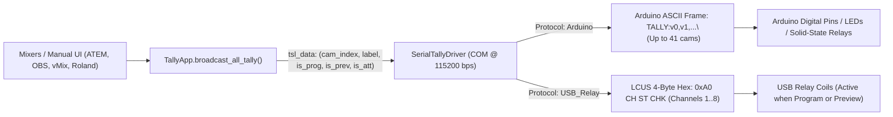
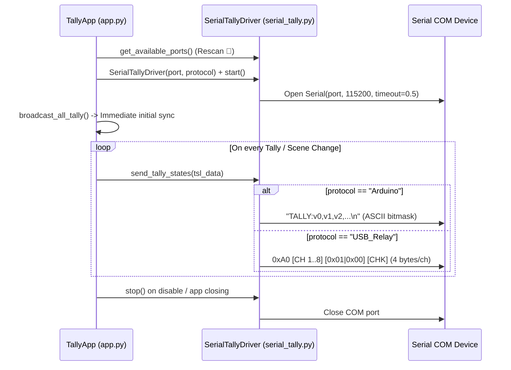

# 📡 Tally Server Pro - ATEM Emulator

Tally Server Pro is a professional-grade, multi-protocol tally server designed for broadcast environments. It emulates an ATEM Tally Server over UDP/9910, allowing DIY Tally Lights (ESP8266/ESP32) and mobile browsers to receive real-time status.

[](https://github.com/paulofernando1/ATEMTallyServer/releases/download/v1.2.0/TallyServerPro.exe)

[](https://github.com/paulofernando1/ATEMTallyServer/wiki)

[Windows v1.2.0 Direct Download](https://github.com/paulofernando1/ATEMTallyServer/releases/download/v1.2.0/TallyServerPro.exe)

[Firmware BIN OTA Direct Download for ESP 8266 With 2 RGB LEDS](https://github.com/paulofernando1/ATEMTallyServer/releases/download/v1.0.1/ESP8266.I2C.Display.BIN.Firmware.v1.0.1.zip)

## 📖 How to Use

### 1. Initial Setup
1. Run `TallyServerEmulator.exe`.
2. Select your **UDP Port** (Default: `9910`).
3. Click **"Start Server"**. The button will turn green, indicating the UDP engine is active.

### 2. Integration (vMix / OBS)
- **vMix:** Enter the vMix computer IP and port (`8099`). Click **"Connect vMix"**. 
- **OBS Studio:** Enter the IP, port (`4455`), and password. Ensure "WebSocket Server" is enabled in OBS (Tools -> WebSocket Server Settings). Click **"Connect OBS"**.
- The dashboard will now automatically sync Program/Preview states based on your production software names.

### 3. Tally Lights Management
- **Hardware Tallies:** Flash your ESP8266/ESP32 with the provided firmware. Set the "Switcher IP" to your computer's IP.
- **Role Assignment:** In the "Active Network Clients" dashboard, assign a Cam ID to each IP.
- **Status Orbs:** Green orbits indicate the tally is connected and ready.

### 4. Web Tally (Mobile/Tablet)
1. In the "ATEM Tally Server" card, enter a **Web Port** (Default: `8080`).
2. Click **"Start Web Tally"**.
3. On your phone/tablet, browse to `http://<YOUR_COMPUTER_IP>:8080`.
4. **Offline Support:** The server now hosts all dependencies (Socket.IO) locally, allowing it to work on closed production networks without internet access.
5. **Force Re-Sync:** If a mobile client loses connection or fails to update, use the **"FORCE RE-SYNC"** button on the mobile screen to refresh states.
6. **Assign Role:** Select your camera role (Cam 1-41) directly from the mobile browser dropdown.

## 5. LED pins defined on default ESP firmware

**ESP32:**
 
 LED1
1. RED = PIN 32
2. GREEN = PIN 32
3. BLUE = PIN 25

 LED2
1. RED = PIN 26
2. GREEN = PIN 27
3. BLUE = PIN 14

**ESP8266:**
 
 LED1
1. RED = PIN 16
2. GREEN = PIN 5
3. BLUE = PIN 0

 LED2
1. RED = PIN 2
2. GREEN = PIN 13
3. BLUE = PIN 15

## 6. I2C Display pins defined on default ESP Firmware
**ESP32 / ESP82266 / NodeMCU**
 
OLED SCL = PIN 12
OLED SDA = PIN 14

## 7. USB Serial & Hardware Relays (Output)

The **USB Serial & Relays** output module ([serial_tally.py](serial_tally.py)) drives wired studio tally lights, Arduino serial shields, GPI interfaces, and USB relay boards (LCUS-1, LCUS-2, and 4/8-channel CH340/FTDI modules) directly over a local COM port using `pyserial` (`115200 bps`, `8N1`, `timeout=0.5s`, thread-safe via `threading.Lock()`).

### Architecture & Data Flow



### Runtime Sequence



### UI Configuration
1. In the left sidebar dropdown, select **`USB Serial & Relays (Output)`**.
2. Click **🔄** (`refresh_serial_ports`) if the USB adapter was plugged in after launch, then pick the target **COM Port**.
3. Choose the **Protocol** (`Arduino` or `USB_Relay`).
4. Click **Enable USB Serial** (`toggle_serial`) to open the port and immediately transmit the current tally snapshot (`broadcast_all_tally`). *(Optional: enable **Auto Enable USB Serial** in Settings to reconnect automatically on startup.)*

### Protocol 1: `Arduino` (ASCII Serial — up to 41 Cameras)
Emits one newline-terminated ASCII line per update at `115200 bps`:
```text
TALLY:<v0>,<v1>,<v2>,...\n
```
Each integer value is a bitmask computed from `(is_prog, is_prev)`:

| Value | Binary | State |
| :---: | :---: | :--- |
| `0` | `00` | Off (Idle) |
| `1` | `01` | Program (`RED` / On-Air) |
| `2` | `10` | Preview (`GREEN`) |
| `3` | `11` | Program + Preview active simultaneously |

**Minimal Arduino Receiver Example (`115200 bps`):**
```cpp
// Reads "TALLY:v0,v1,v2,...\n" and drives Cam 1 Program (pin 2) & Preview (pin 3)
void setup() {
  Serial.begin(115200);
  pinMode(2, OUTPUT); // Cam 1 Program
  pinMode(3, OUTPUT); // Cam 1 Preview
}

void loop() {
  if (!Serial.available()) return;
  String line = Serial.readStringUntil('\n');
  if (!line.startsWith("TALLY:")) return;
  int cam1Flag = line.substring(6).toInt(); // First camera value before first comma
  digitalWrite(2, (cam1Flag & 1) ? HIGH : LOW);
  digitalWrite(3, (cam1Flag & 2) ? HIGH : LOW);
}
```

### Protocol 2: `USB_Relay` (LCUS Binary Hex — Channels 1 to 8)
Built for **LCUS-1**, **LCUS-2**, and 4/8-channel CH340/FTDI USB relay boards. Only the first 8 cameras (`tally_list[:8]`) are mapped to physical relay channels `1..8`, and a relay turns **ON** whenever that camera is in **Program OR Preview** (`is_on = item[2] or item[3]`).

Each channel command is a 4-byte frame `[0xA0, channel, state, checksum]`, where:
- `0xA0`: Start header byte
- `channel`: `0x01` .. `0x08` (`cam_index + 1`)
- `state`: `0x01` (ON) or `0x00` (OFF)
- `checksum`: `(0xA0 + channel + state) & 0xFF`

| Channel | Action | Hex Frame |
| :---: | :---: | :--- |
| `1` | ON | `A0 01 01 A2` |
| `1` | OFF | `A0 01 00 A1` |
| `2` | ON | `A0 02 01 A3` |
| `2` | OFF | `A0 02 00 A2` |

> **Baud Rate Note:** `SerialTallyDriver` initializes ports at `115200 bps` by default. Most CH340 Arduino shields use `115200 bps`; if your specific LCUS relay hardware only accepts `9600 bps`, adjust `baudrate=115200` in [serial_tally.py](serial_tally.py) (`SerialTallyDriver.__init__`).


---

## 🛠️ Technical Details

| Service | Port | Protocol | Usage |
| :--- | :--- | :--- | :--- |
| **ATEM Tally Server** | `9910` | UDP | Main tally communication for DIY lights (Binary Protocol) |
| **ATEM Switcher Client**| `9910` | UDP | Input connector for Blackmagic ATEM hardware switchers |
| **Hollyland / TSL UMD** | `8900` | UDP | Universal TSL 3.1 output for Hollyland Tally & Monitors |
| **Web UI** | `8080` | TCP | Mobile tally clients (Flask/SocketIO) |
| **vMix API** | `8099` | TCP | Input state polling (TCP Bridge, up to 41 inputs) |
| **OBS WS** | `4455` | TCP | Scene monitoring (WebSocket 5.5+) |
| **Roland Switcher** | `8023` | TCP | Hardware tally polling (QPL / QST / QPG / QPV) |
| **OSC Universal Bridge** | `9000` / `8000` | UDP | Bidirectional OSC tally output and triggers |
| **USB Serial & Relays** | `COM` (`115200 bps`) | Serial | Arduino ASCII (`TALLY:...`) and LCUS USB Relay (`0xA0`) output |

## 🔥 Key Features (v2.5)
- **High Capacity:** Supports up to 41 simultaneous Tally lights (hardware or web).
- **Universal Multi-Protocol:** Supports Blackmagic ATEM, Hollyland Tally (TSL 3.1), vMix, OBS Studio, and WebSockets.
- **Repeater Mode:** Built-in support for hardware units acting as repeaters.
- **Smart Logic:** Automatic tally flag merging (Program + Preview + RGB Overrides).
- **RGB Support:** Experimental RGB LED2 support for specialized lighting requirements.
- **Persistent Memory:** All scene mappings, hardware IPs, and port configurations are auto-saved to `config.json`.

## 📦 Building from Source

To compile the application into a standalone portable `.exe`:
1. Use Python 3.14 (or 3.10+).
2. Install dependencies: `pip install customtkinter flask flask-socketio requests obsws-python websocket-client qrcode[pil] pyserial`.
3. Run the build script:
   ```powershell
   powershell -ExecutionPolicy Bypass -File build.ps1
   ```
## Pending Features (Next Release)
- **Neopixels Tests** 
- **Other Compatible Hardware Switchers Tests**
- **ESP32 Hardware Compatibility Tests**  

---
Based on ATEM libraries for Arduino by [SKAARHOJ](https://www.skaarhoj.com/), available at Git repo: [SKAARHOJ-Open-Engineering](https://github.com/kasperskaarhoj/SKAARHOJ-Open-Engineering)

Ideas and some code based on: [ATEM_Wireless_Tally_Light](https://github.com/kalinchuk/ATEM_Wireless_Tally_Light) and [ATEM_tally_light_with_ESP8266](https://github.com/AronHetLam/ATEM_tally_light_with_ESP8266)

*Developed by Paulo Fernando de M. E. - Gandget S&P*
*Developed for professional live production workflows.*
